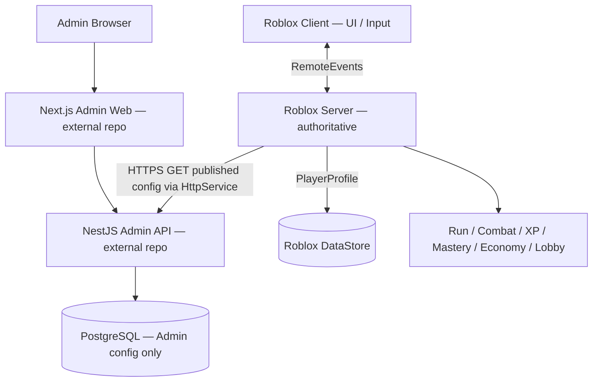

# Beat the Horde — Roblox Runtime Architecture

## Repository ownership

This repository contains **only Roblox Luau/Rojo code**. The following belong to other repositories:

- `beat-the-horde-docs`: DOC-01/GDD, DOC-02/GSD, DOC-03/Balance Calculator, DOC-04/TDD, architecture diagrams and design decisions.
- `beat-the-horde-admin`: Next.js Admin Web, NestJS Admin API, Prisma, PostgreSQL, publishing and config audit.

## Runtime boundaries

## Source of truth

| Data | Owner |
| --- | --- |
| Coins, Diamonds, unlocks, permanent gear, Tome slots | Roblox DataStore |
| Gold, current HP/XP/Mastery, current run build | Roblox server RAM |
| Balance drafts, published versions, admin permissions/audit | Admin PostgreSQL |
| API contract specification | Docs repo, versioned copies implemented by Admin/Roblox |

Never send per-hit or per-orb HTTP calls. Never grant XP, purchases, or damage based only on client assertions. Admin publishes versioned configs; Roblox validates and snapshots them at the beginning of a run.

## Rojo ownership

`src/shared` -> `ReplicatedStorage/Shared`, `src/server` -> `ServerScriptService/GameServer`, `src/client` -> `StarterPlayer/StarterPlayerScripts/GameClient`. Map, Terrain, Lighting and visual StarterGui remain owned by Roblox Studio/Team Create designers, not Rojo.

## Implementation maturity

The majority of service modules are **scaffold placeholders**. `ConfigService` contains only partial JSON checks and does not have production authentication, schema/integrity validation, durable fallback, retry or startup wiring. `Bootstrap` creates remote events but does **not** provide business handlers. This repository cannot yet run an entire gameplay loop.
